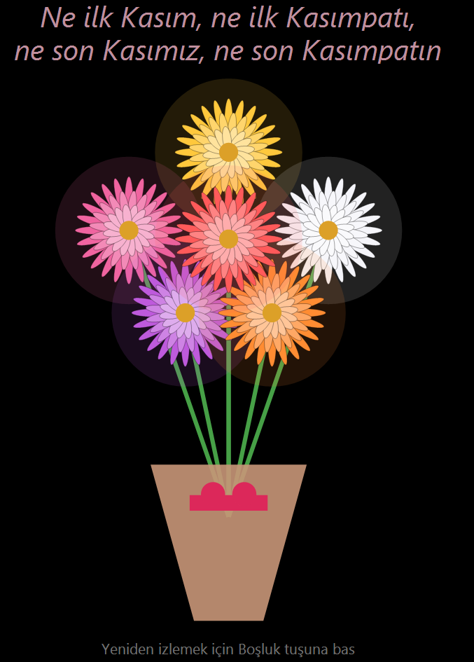

# Kasımpatı Buketi 🌼

C# ve Windows Forms ile yazılmış animasyonlu bir kasımpatı buketi. Siyah bir arka planda saplar büyür, çiçekler tek tek açılır.

## Nasıl çalıştırılır?

1. Windows bilgisayarına .NET SDK kur (dotnet.microsoft.com).
2. Bu depoyu indir ya da klonla.
3. Proje klasöründe terminal aç ve `dotnet run` yaz.

## Kullanım

- Çiçekler sırayla açılır, en sonda yazı belirir.
- Animasyonu baştan izlemek için **Boşluk** tuşuna bas.
- Pencereyi büyütebilirsin, buket ortada kalır ve pencereyle birlikte büyür.

## Kullanılan teknolojiler

- C#
- Windows Forms (System.Drawing ile çizim)
- .NET